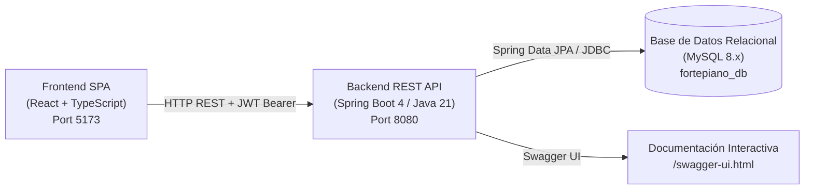

# Duoc UC — Escuela de Informática y Telecomunicaciones
## Especificación de Requisitos de Software (ERS)

**Proyecto:** Forte & Piano — Tienda Online de Instrumentos Musicales  
**Estándar:** Conforme a IEEE 830-1998  
**Revisión:** 2.0 (Actualización de Arquitectura Fullstack Backend Spring Boot)  
**Fecha:** Noviembre 2026  
**Asignatura:** Desarrollo Fullstack II (`DSY1104`) — Evaluación Parcial N° 3  

---

### Ficha del Documento

| Fecha | Revisión | Autor | Modificación |
| :--- | :---: | :--- | :--- |
| 07/09/2026 | 1.0 | Equipo de Desarrollo Frontend Duoc UC | Creación y estructuración completa del documento ERS para la aplicación Forte & Piano según estándar IEEE 830 (Frontend HTML5/JS/localStorage). |
| 22/11/2026 | 2.0 | Patricio Céspedes, Daniel Aedo, Angelo Ponce | **Actualización mayor de arquitectura hacia Fullstack**: Reemplazo de persistencia en localStorage por **Backend REST API en Spring Boot 4 / Java 21**, base de datos relacional **MySQL (`fortepiano_db`)**, seguridad **Spring Security con JWT y BCrypt**, control de roles **RBAC**, pasarela de pago simulada transaccional, control de stock en BD, dashboard estadístico y documentación interactiva **Swagger/OpenAPI 3**. |

**Documento validado por las partes:**

| Por el Cliente / Docente Evaluador | Por el Equipo Suministrador / Desarrolladores |
| :--- | :--- |
| **Firma:** ___________________________ **Nombre:** Docente Evaluador DSY1104 **Institución:** Duoc UC | **Firma:** ___________________________ **Nombre:** Patricio Céspedes (Módulo A: Seguridad e Identidad) **Nombre:** Daniel Aedo (Módulo B: Catálogo, Checkout y Boletas) **Nombre:** Angelo Ponce (Módulo C: Blog, Contacto y Dashboard) |

---

## 1. Introducción

El presente documento formaliza la **Especificación de Requisitos de Software (ERS) Versión 2.0** para la plataforma de comercio electrónico **Forte & Piano**, desarrollada en estricta conformidad con el estándar **IEEE 830-1998**. Provee el marco de diseño funcional, no funcional, arquitectónico y técnico tanto para los evaluadores académicos como para el equipo de desarrollo de software.

### 1.1. Propósito
El propósito de esta ERS es detallar de manera formal y no ambigua los requerimientos funcionales, requerimientos no funcionales, reglas de negocio, modelos de persistencia e interfaces que constituyen la solución integral de Forte & Piano bajo una arquitectura desacoplada Fullstack (Frontend React + Backend Spring Boot + BD MySQL).

Este documento está dirigido a:
- **Equipo de desarrollo Fullstack de Duoc UC**: Responsable de la codificación, pruebas unitarias y despliegue del frontend y backend.
- **Docentes y evaluadores de la asignatura DSY1104**: Encargados de la verificación y validación del cumplimiento de los requisitos del proyecto.
- **Administradores y usuarios de negocio**: Interesados en la operatividad, seguridad y rendimiento de la plataforma.

### 1.2. Ámbito del Sistema
**Nombre del Sistema:** Forte & Piano — E-Commerce de Pianos, Teclados y Accesorios Musicales.

#### Lo que el sistema HACE:
- Provee una **API RESTful stateless** desarrollada en **Spring Boot 4 y Java 21**, con endpoints estructurados bajo el prefijo `/api/v1/...`.
- Gestiona la persistencia de datos en una base de datos relacional **MySQL 8.x (`fortepiano_db`)** con integridad referencial completa y control de transacciones ACID.
- Ofrece un subsistema de autenticación y autorización robusto mediante **Spring Security y JSON Web Tokens (JWT)** con algoritmo de firma HMAC-SHA y contraseñas cifradas con **BCrypt**.
- Implementa control de acceso basado en roles (**RBAC**) con 3 perfiles diferenciados: **Administrador (`rolId=1`)**, **Vendedor (`rolId=2`)** y **Cliente (`rolId=3`)**.
- Expone un catálogo dinámico de instrumentos musicales con soporte de inventario en tiempo real, alertas de stock crítico y cálculo automatizado de precios de oferta con porcentaje de descuento.
- Procesa compras mediante un **Checkout transaccional con pasarela de pago simulada**, gestionando 3 escenarios de negocio (`exitoso`, `rechazado`, `intentar_mas_tarde`), emitiendo boletas electrónicas con desglose de IVA (19%) y Neto, y descontando o restituyendo stock en base de datos.
- Ofrece un panel de administración con **Dashboard estadístico en tiempo real** que consolida ventas totales, cantidad de pedidos, distribución por estados y productos más vendidos.
- Implementa validaciones estrictas en el servidor: validación de **RUN chileno mediante algoritmo Módulo 11** (rechazando RUNs sin dígito verificador) y lista blanca de dominios de correo permitidos (`@duoc.cl`, `@profesor.duoc.cl`, `@gmail.com`).
- Incorpora sembrado automático de datos mediante componentes independientes `@Order(1..3)` (`CommandLineRunner`).
- Expone documentación viva e interactiva a través de **Swagger UI / OpenAPI 3**.

#### Lo que el sistema NO HACE:
- No procesa transacciones con dinero real en pasarelas bancarias externas de producción (ej. Transbank Webpay Plus o PayPal); opera con una pasarela bancaria simulada transaccional conforme a los requisitos de la evaluación académica.
- No realiza despacho logístico físico real (simula el cálculo y almacenamiento de datos de envío y destinatario).

### 1.3. Definiciones, Acrónimos y Abreviaturas
- **ERS:** Especificación de Requisitos de Software (IEEE 830).
- **IEEE:** Institute of Electrical and Electronics Engineers.
- **REST:** Representational State Transfer (Estilo arquitectónico para servicios web).
- **API:** Application Programming Interface (Interfaz de Programación de Aplicaciones).
- **JWT:** JSON Web Token (Estándar RFC 7519 para tokens de seguridad compactos y autofirmados).
- **BCrypt:** Función de hash criptográfico adaptativa para protección de contraseñas.
- **RBAC:** Role-Based Access Control (Control de acceso basado en roles).
- **JPA / ORM:** Java Persistence API / Object-Relational Mapping (Mapeo objeto-relacional con Hibernate).
- **CRUD:** Create, Read, Update, Delete (Operaciones de persistencia básicas).
- **CORS:** Cross-Origin Resource Sharing (Mecanismo de seguridad para solicitudes entre distintos orígenes).
- **RUN:** Rol Único Nacional (Identificador fiscal y tributario chileno de personas naturales).
- **Stock Crítico:** Umbral numérico mínimo de inventario tras el cual se generan alertas operativas.
- **ACID:** Atomicidad, Consistencia, Aislamiento y Durabilidad en transacciones de bases de datos.

### 1.4. Referencias
- Estándar IEEE 830-1998: *IEEE Recommended Practice for Software Requirements Specifications*.
- Pauta de Evaluación DSY1104: *Desarrollo Fullstack II — Escuela de Informática y Telecomunicaciones, Duoc UC*.
- Documentación Oficial de Spring Boot 4 y Spring Security 7.
- Especificación OpenAPI 3.0 / SpringDoc OpenAPI UI.

### 1.5. Visión General del Documento
El documento se estructura en tres secciones: la presente **Introducción** (Sección 1); la **Descripción General** (Sección 2), que aborda la perspectiva arquitectónica, modelo de dominio, perfiles y restricciones; y los **Requisitos Específicos** (Sección 3), que detallan rigurosamente las interfaces del sistema, el catálogo completo de requisitos funcionales (RF01 a RF16) y los requerimientos no funcionales de calidad.

---

## 2. Descripción General

### 2.1. Perspectiva del Producto
Forte & Piano opera bajo una **arquitectura en capas desacoplada (Cliente-Servidor / 3 Capas)**:
1. **Capa de Presentación (Frontend SPA):** Desarrollada en **React + TypeScript + Vite**, ejecutándose en el cliente (`http://localhost:5173`). Consume los servicios del backend mediante peticiones asíncronas HTTP/REST y almacena el token JWT de sesión.
2. **Capa de Negocio y Servicios (Backend REST):** Desarrollada en **Spring Boot 4 / Java 21**, ejecutándose en el servidor (`http://localhost:8080`). Contiene los controladores REST, la lógica transaccional de negocio, validaciones de seguridad y filtros JWT.
3. **Capa de Persistencia y Datos:** Gestionada por **MySQL 8.x (`fortepiano_db`)** a través de Spring Data JPA e Hibernate ORM, garantizando integridad referencial y atomicidad transaccional.

### 2.2. Funciones del Producto
A nivel macro, el sistema ofrece cuatro subsistemas integrados:
1. **Subsistema de Tienda Pública:** Catálogo dinámico de instrumentos, filtros por categoría y búsqueda, detalle de producto con ficha técnica, carrito de compras persistente, blog de difusión musical y formulario de contacto.
2. **Subsistema de Autenticación e Identidad:** Registro de clientes con validación Módulo 11, inicio de sesión seguro, emisión de JWT, recuperación de sesión actual (`/auth/me`) y actualización de perfil de usuario.
3. **Subsistema de Checkout, Órdenes y Pasarela Simulada:** Procesamiento transaccional de compras, simulación de respuestas de pago (`exitoso`, `rechazado`, `intentar_mas_tarde`), cálculo de impuestos (IVA 19%), emisión de boletas, consulta de historial personal ("Mis Boletas"), reintento de pago y anulación con reposición de inventario.
4. **Subsistema Administrativo y Estadístico:** Panel de control con métricas en tiempo real (ventas totales, distribución por estados, ranking de productos y alertas de stock crítico), mantenedores CRUD de catálogo y categorías, y administración de usuarios y roles.

### 2.3. Características de los Usuarios y Roles (RBAC)

| Rol / Perfil | Nivel Técnico | Permisos y Responsabilidades en el Sistema |
| :--- | :--- | :--- |
| **Administrador (`rolId=1`)** | Técnico / Profesional; gestión de datos y ventas. | **Acceso total e irrestricto**: Mantenedor CRUD de usuarios, creación y edición de productos y categorías, anulación de boletas con reposición de stock, visualización de todas las órdenes, bandeja de contactos y acceso completo al Dashboard estadístico. |
| **Vendedor (`rolId=2`)** | Medio / Técnico; atención comercial e inventario. | Visualización del catálogo de productos y stock, consulta y seguimiento de todas las órdenes/boletas del sistema, y acceso al Dashboard estadístico y reportes de ventas. **Restringido**: no puede crear/modificar usuarios, no puede crear/editar/eliminar productos ni categorías, y no puede anular boletas. |
| **Cliente (`rolId=3`)** | Usuario general. | Navegación de tienda, gestión de carrito de compras, ejecución de Checkout con pasarela de pago, consulta de su historial exclusivo de compras (`/boletas/mis-boletas`) y actualización de su propio perfil de usuario. |
| **Público / Invitado** | General sin autenticar. | Exploración de catálogo, lectura de blog, envío de mensajes por formulario de contacto, inicio de sesión y registro de cuenta nueva. |

### 2.4. Restricciones del Sistema
- **Lenguaje y Framework:** Java 21 LTS y Spring Boot 4.
- **Persistencia Exclusiva en BD Relacional:** Se prohíbe el uso de `localStorage` para almacenamiento permanente de entidades de negocio (usuarios, productos, boletas); la persistencia reside en MySQL `fortepiano_db`.
- **Arquitectura Stateless:** No se almacena sesión en memoria de servidor (`SessionCreationPolicy.STATELESS`); toda petición protegida debe autenticarse vía Bearer Token JWT.
- **Políticas de CORS:** Acceso restringido exclusivamente a los orígenes del frontend (`http://localhost:5173`, `http://127.0.0.1:5173`).
- **Validaciones de Integridad:** Obligatoriedad de validación del RUN chileno mediante algoritmo Módulo 11 en el backend, rechazando cualquier RUN sin dígito verificador.
- **Transaccionalidad ACID:** Operaciones críticas que involucren compras o anulaciones deben ejecutarse bajo anotación `@Transactional`.

### 2.5. Suposiciones y Dependencias
- Servidor de base de datos MySQL 8.x en ejecución en `localhost:3306`.
- Disponibilidad del entorno de ejecución Java 21 JDK en la máquina anfitriona.
- Navegador web moderno con soporte para ECMAScript 6+ y almacenamiento de tokens.

---

## 3. Requisitos Específicos

### 3.1. Requisitos Comunes de las Interfaces

#### 3.1.1. Interfaces de Usuario
- SPA responsiva adaptada a dispositivos móviles (360px+), tablets y pantallas de escritorio.
- Alertas y confirmaciones visuales dinámicas (SweetAlert2 / Modales).
- Navegación diferenciada según rol detectado en el token JWT.

#### 3.1.2. Interfaces de Software y Protocolos
- **Servidor de Aplicación:** Spring Boot 4 con motor embebido Apache Tomcat.
- **ORM / Mapeo Relacional:** Spring Data JPA con Hibernate ORM 7.
- **Motor de Base de Datos:** MySQL Connector/J 8.x (producción/desarrollo) y H2 Database en memoria (pruebas unitarias automatizadas).
- **Mecanismo de Seguridad:** Spring Security 7 con filtro personalizado `JwtAuthenticationFilter`.
- **Documentación API:** SpringDoc OpenAPI v2 / Swagger UI 3.
- **Protocolo de Comunicación:** HTTP/1.1 RESTful con payloads en formato JSON (UTF-8).

---

### 3.2. Requisitos Funcionales Detallados

#### RF01: Inicialización y Sembrado de Datos Maestros (Seeders)
- **Actores:** Sistema / Servidor Spring Boot.
- **Descripción:** Al iniciar la aplicación, el backend debe verificar automáticamente si existen registros en la base de datos MySQL `fortepiano_db`. Mediante componentes `@Order(1..3)`, poblará automáticamente:
  - `@Order(1) UsuariosSeeder`: 3 Roles (Admin, Vendedor, Cliente), 3 Regiones, 7 Comunas y 4 Usuarios semilla (`admin@gmail.com`, `vendedor@gmail.com`, `camila@gmail.com`, `diego@duoc.cl`) con contraseñas cifradas en BCrypt.
  - `@Order(2) CatalogoBoletasSeeder`: 6 Categorías, 8 Productos de catálogo (con ofertas activas en `AD-001`, `PD-001`, `SY-001`, `PD-002`) y 5 Boletas históricas con sus detalles.
  - `@Order(3) ContenidoSeeder`: 3 Noticias completas del blog con sus párrafos correspondientes.

#### RF02: Registro de Nuevos Clientes
- **Actores:** Cliente / Público General.
- **Descripción:** Permite a un nuevo usuario crear una cuenta de cliente (`rolId = 3`) mediante `POST /api/v1/auth/registro`.
- **Validaciones de Entrada:**
  - `run`: Obligatorio, validado estrictamente con algoritmo **Módulo 11** (cuerpo + dígito verificador).
  - `nombre` y `apellidos`: Obligatorios, alfabéticos.
  - `correo`: Obligatorio, único en la base de datos y validado con lista blanca institucional (`@duoc.cl`, `@profesor.duoc.cl`, `@gmail.com`).
  - `password`: Obligatoria, encriptada con algoritmo BCrypt antes de persistir.
  - `regionId`, `comunaId`, `direccion`: Opcionales/Requeridos para despacho.
- **Salida:** Código HTTP `201 Created` con el token JWT de acceso y los datos de la sesión creada.

#### RF03: Autenticación de Usuarios y Control de Acceso (Login)
- **Actores:** Cliente, Vendedor, Administrador.
- **Descripción:** Permite el inicio de sesión mediante `POST /api/v1/auth/login` validando correo y contraseña.
- **Procesamiento:** El sistema verifica que el usuario exista, que su estado sea "Activo" y que la contraseña coincida mediante `passwordEncoder.matches()`. Genera un token JWT firmado digitalmente con los claims del usuario (`run`, `correo`, `rolId`, `nombre`).
- **Salida:** Código HTTP `200 OK` con payload `{ exito: true, token: "...", sesion: { run, nombre, apellidos, correo, rolId, rolNombre } }` o `401 Unauthorized` si las credenciales son erróneas.

#### RF04: Persistencia y Consulta de Sesión Activa (`/auth/me`)
- **Actores:** Usuario Autenticado.
- **Descripción:** Endpoint `GET /api/v1/auth/me` que recibe el token JWT en el encabezado `Authorization: Bearer <token>` y devuelve la información actualizada de la sesión del usuario.
- **Propósito:** Permite al frontend React recuperar el estado de autenticación ante recargas de página (`F5`) sin solicitar credenciales nuevamente.

#### RF05: Actualización de Perfil de Usuario
- **Actores:** Usuario Autenticado (Cliente, Vendedor, Admin).
- **Descripción:** Mediante `PUT /api/v1/auth/perfil`, el usuario modifica sus datos de contacto, dirección y ubicación geográfica. Utilizado también por el Checkout para consolidar los datos del comprador.

#### RF06: Mantenimiento Integral de Usuarios (CRUD Administrativo)
- **Actores:** Administrador (`ROLE_ADMIN`).
- **Descripción:** Endpoints `/api/v1/usuarios`:
  - `GET /api/v1/usuarios`: Listar todos los usuarios.
  - `GET /api/v1/usuarios/{run}`: Obtener usuario específico por RUN.
  - `POST /api/v1/usuarios`: Creación manual de usuarios administrativos o vendedores con encriptación BCrypt y validación Módulo 11.
  - `PUT /api/v1/usuarios/{run}`: Modificación de roles, datos personales o bloqueo de estado (`Inactivo`).
  - `DELETE /api/v1/usuarios/{run}`: Eliminación física de cuenta.

#### RF07: Catálogo de Productos y Ofertas Dinámicas
- **Actores:** Público General, Cliente, Vendedor, Administrador.
- **Descripción:** Endpoints públicos de lectura:
  - `GET /api/v1/productos`: Lista de productos con soporte de filtros por texto (`?texto=`), categoría (`?categoriaId=`) y promociones (`?enOferta=true`).
  - `GET /api/v1/productos/{codigo}`: Ficha técnica detallada por SKU.
- **Regla de Negocio de Ofertas:** Si el producto tiene `enOferta = true` y posee un `porcentajeDescuento > 0`, el backend calcula automáticamente el `precioOferta = Math.round(precio * (1 - porcentajeDescuento / 100.0f))`.

#### RF08: Mantenimiento de Productos y Categorías (CRUD Admin)
- **Actores:** Administrador (`ROLE_ADMIN`).
- **Descripción:** 
  - Gestión de Categorías: `POST /api/v1/categorias`, `DELETE /api/v1/categorias/{id}` (con validación de no poseer productos vinculados).
  - Gestión de Productos: `POST /api/v1/productos`, `PUT /api/v1/productos/{codigo}`, `DELETE /api/v1/productos/{codigo}`.
  - Control de Inventario: Alerta si `stock <= stockCritico`.

#### RF09: Checkout y Pasarela de Pago Simulada
- **Actores:** Cliente Autenticado (`ROLE_CLIENTE`), Administrador.
- **Descripción:** Mediante `POST /api/v1/boletas/checkout`, el sistema procesa la orden de compra con soporte para 3 resultados de simulación financiera (`resultadoTransaccion`):
  1. **`exitoso`:**
     - Valida disponibilidad de stock de cada ítem.
     - **Descuenta el stock en la base de datos MySQL**.
     - Calcula `subtotalNeto = Math.round(total / 1.19f)` e `iva = total - subtotalNeto`.
     - Guarda la boleta con estado **`Emitida`**.
  2. **`rechazado`:**
     - No descuenta stock y registra la boleta con estado **`Rechazada`**.
  3. **`intentar_mas_tarde`:**
     - No descuenta stock y registra la boleta con estado **`Pendiente`**.
- **Atomicidad:** Toda la operación se ejecuta dentro de una transacción `@Transactional`.

#### RF10: Consulta e Historial de Boletas de Compra
- **Actores:** Cliente, Vendedor, Administrador.
- **Descripción:**
  - `GET /api/v1/boletas/mis-boletas`: Retorna exclusivamente las compras realizadas por el cliente autenticado (identificado a partir de su token JWT).
  - `GET /api/v1/boletas`: Listado general de órdenes para Vendedores y Administradores con filtro por cliente y estado.
  - `GET /api/v1/boletas/{id}`: Detalle completo de la boleta, ítems adquiridos y datos de envío.

#### RF11: Recuperación de Compras y Reintento de Pago
- **Actores:** Cliente Autenticado, Administrador.
- **Descripción:** Mediante `PUT /api/v1/boletas/{id}/reintentar-pago`, permite reintentar el pago de órdenes con estado `Pendiente` o `Rechazada`. Si el nuevo resultado es `exitoso`, valida stock disponible, descuenta unidades de MySQL y actualiza el estado a `Emitida`.

#### RF12: Anulación de Boletas con Devolución de Stock
- **Actores:** Exclusivo Administrador (`ROLE_ADMIN`).
- **Descripción:** Mediante `PUT /api/v1/boletas/{id}/anular`, cambia el estado de una boleta `Emitida` a `Anulada` y **restituye automáticamente el stock** de todos sus productos en la base de datos MySQL.

#### RF13: Publicación y Difusión de Noticias (Blog Musical)
- **Actores:** Público General.
- **Descripción:** `GET /api/v1/noticias` (listado) y `GET /api/v1/noticias/{slug}` (lectura completa con párrafos ordenados).

#### RF14: Formulario de Contacto y Feedback
- **Actores:** Público General, Administrador, Vendedor.
- **Descripción:**
  - `POST /api/v1/contactos`: Envío público de mensajes validando formato, dominio de correo y límite de 500 caracteres.
  - `GET /api/v1/contactos`: Bandeja de entrada administrativa protegida para revisión de mensajes.

#### RF15: Dashboard Estadístico y Reportes en Tiempo Real
- **Actores:** Administrador, Vendedor.
- **Descripción:** Endpoint `GET /api/v1/dashboard/resumen` que calcula y consolida métricas clave:
  - `ventasTotales`: Sumatoria de montos de boletas con estado `Emitida`.
  - `cantidadPedidos`: Conteo total de órdenes.
  - `unidadesVendidas`: Suma total de unidades despachadas.
  - `distribucionEstados`: Cantidad y porcentaje de pedidos en estados `Emitida`, `Pendiente`, `Rechazada` y `Anulada`.
  - `productosMasVendidos`: Ranking top 5 de productos por unidades e ingresos.
  - `productosMayorStock` y alertas de `productosStockCritico`.

#### RF16: Documentación Interactiva y Pruebas en Vivo (Swagger / OpenAPI)
- **Actores:** Desarrolladores, Docentes Evaluadores.
- **Descripción:** Interfaz gráfica Swagger UI accesible en `http://localhost:8080/swagger-ui.html` con catálogo completo de endpoints agrupados por tags y botón **Authorize** para inyectar el Bearer Token JWT.

---

### 3.3. Requisitos No Funcionales (Atributos de Calidad)

#### 3.3.1. Requisitos de Rendimiento
- **Tiempo de Respuesta de API:** Las operaciones de lectura (`GET`) deben responder en menos de **100 milisegundos** bajo condiciones estándar de red local.
- **Transacciones de Escritura:** Las operaciones transaccionales compuestas (Checkout y Anulación con actualización de stock) deben completarse en menos de **250 milisegundos**.
- **Pool de Conexiones:** Gestión optimizada mediante **HikariCP** para alta concurrencia de conexiones JDBC hacia MySQL.

#### 3.3.2. Seguridad
- **Protección de Contraseñas:** Algoritmo **BCrypt con factor de costo 10**, garantizando que ninguna contraseña se almacene en texto plano.
- **Autenticación Robusta:** Tokens **JWT (JSON Web Tokens)** firmados con clave simétrica secreta de 256 bits y expiración configurable (24 horas por defecto).
- **Control de Acceso Basado en Roles (RBAC):** Restricción de endpoints mediante Spring Security y anotaciones `@PreAuthorize` / `hasRole()`.
- **Prevención de Ataques Web:** 
  - Prevención de **SQL Injection** mediante consultas parametrizadas de Hibernate / Spring Data JPA.
  - Prevención de ataques **Cross-Site Scripting (XSS)** mediante saneamiento de DTOs y validaciones de entrada.
  - Protección de acceso mediante **CORS** restringido exclusivamente a `http://localhost:5173`.

#### 3.3.3. Fiabilidad e Integridad Transaccional
- **Propiedades ACID:** Toda operación de mutación que afecte más de una tabla (ej. Boleta + Ítems + Descuento de Stock) se ejecuta bajo `@Transactional`; si ocurre cualquier excepción, se realiza rollback automático impidiendo inconsistencias de stock.
- **Pruebas Automatizadas:** Cobertura de pruebas unitarias con **JUnit 5 y Mockito** ejecutadas contra base de datos en memoria **H2** (**58 pruebas pasando con 0 fallos**).

#### 3.3.4. Disponibilidad y Escalabilidad
- **Arquitectura Stateless:** Al no mantener sesión en el servidor, la API permite balanceo de carga y escalabilidad horizontal transparente.
- **Tolerancia a Fallos:** Manejo global de excepciones con respuestas estructuradas mediante `ApiErrorDto`.

#### 3.3.5. Mantenibilidad y Calidad de Código
- **Separación de Responsabilidades:** Arquitectura por capas estricta: `controller` -> `service` -> `repository` -> `entity` / `dto` / `security`.
- **Desarrollo Paralelo Limpio:** Desacoplamiento modular vertical (Módulo A: Patricio, Módulo B: Daniel, Módulo C: Angelo) con cero archivos compartidos durante el desarrollo.

#### 3.3.6. Portabilidad
- Compatibilidad multi-plataforma garantizada por la Máquina Virtual de Java (**JVM 21+**), ejecutable de forma idéntica en Windows 10/11, distribuciones GNU/Linux y macOS.

---

### 3.4. Matriz de Trazabilidad: Requisitos vs. Endpoints vs. Roles

| ID Req. | Endpoint Asociado | Método | Rol Permitido | Tipo de Operación |
| :---: | :--- | :---: | :--- | :--- |
| **RF01** | *Interno (Seeders al iniciar)* | — | Sistema | Inserción de semillas maestras |
| **RF02** | `/api/v1/auth/registro` | POST | Público / Invitado | Registro con validación Módulo 11 |
| **RF03** | `/api/v1/auth/login` | POST | Público / Invitado | Autenticación y entrega de JWT |
| **RF04** | `/api/v1/auth/me` | GET | Admin, Vendedor, Cliente | Recuperación de sesión activa |
| **RF05** | `/api/v1/auth/perfil` | PUT | Admin, Vendedor, Cliente | Actualización de perfil propio |
| **RF06** | `/api/v1/usuarios/**` | GET / POST / PUT / DELETE | Administrador | CRUD completo de usuarios |
| **RF07** | `/api/v1/productos/**` | GET | Público (Todos) | Consulta de catálogo y ofertas |
| **RF08** | `/api/v1/productos/**` | POST / PUT / DELETE | Administrador | Mantenimiento de catálogo |
| **RF08** | `/api/v1/categorias/**` | POST / DELETE | Administrador | Mantenimiento de categorías |
| **RF09** | `/api/v1/boletas/checkout` | POST | Cliente, Administrador | Pago simulado y descuento de stock |
| **RF10** | `/api/v1/boletas/mis-boletas`| GET | Cliente, Administrador | Historial de compras personales |
| **RF10** | `/api/v1/boletas/**` | GET | Administrador, Vendedor | Supervisión general de órdenes |
| **RF11** | `/api/v1/boletas/{id}/reintentar-pago` | PUT | Cliente, Administrador | Recuperación de orden y descuento stock |
| **RF12** | `/api/v1/boletas/{id}/anular` | PUT | Administrador | Anulación y reposición de stock |
| **RF13** | `/api/v1/noticias/**` | GET | Público (Todos) | Difusión de artículos del blog |
| **RF14** | `/api/v1/contactos` | POST | Público (Todos) | Envío de formulario de contacto |
| **RF14** | `/api/v1/contactos` | GET | Administrador, Vendedor | Bandeja de mensajes de clientes |
| **RF15** | `/api/v1/dashboard/resumen` | GET | Administrador, Vendedor | Métricas y gráficos estadísticos |
| **RF16** | `/swagger-ui.html` | GET | Público / Desarrolladores | Documentación interactiva OpenAPI |
